<div align="center">
  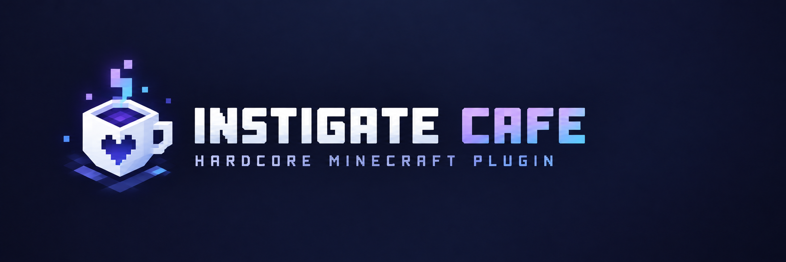
</div>

# Instigate Cafe Hardcore

**One death ends the run for everyone.**

A shared hardcore survival plugin for Minecraft Paper servers. Play together across all three dimensions, survive as long as you can, and start a fresh attempt automatically when someone dies.

**v1.0.4 (Maintenance Mode)** · **Paper 26.3** · **Java 25** · **PacketEvents 2.14.0** (optional, for Deathcam) · **No client mods**

[How it works](#how-it-works) · [Features](#features) · [Gallery](#gallery) · [Installation](#installation) · [Commands](#commands) · [Configuration](#configuration) · [Upgrading](#upgrading-from-v100v103) · [Security](SECURITY.md)

> [!NOTE]
> Instigate Hardcore has completed its planned gameplay scope and is now in **maintenance mode**. Future updates focus on security, data-safety hardening, stability, and critical bug fixes rather than new gameplay features.

---

## How it works

Every run is an **attempt**, shared by everyone playing in its Overworld, Nether, and End.

1. **Survive together.** Players explore a single active attempt while the next world set is prepared in the background.
2. **One player dies.** The attempt ends for the entire group, and everyone moves into spectator mode at the death location.
3. **Watch the final moments.** When PacketEvents is installed and a replay was captured, a seven-second **Deathcam** reconstructs the death, followed by a three-second reset buffer. Otherwise, the normal reset countdown runs.
4. **Begin again.** The standby attempt becomes active, players are reset (including phantom insomnia), the completed worlds are safely retired and cleaned up, and another standby attempt is prepared — **no server restart required**.

`ACTIVE ATTEMPT` → `PLAYER DEATH` → `7s DEATHCAM + 3s BUFFER` → `STANDBY PROMOTED` → `NEW ATTEMPT`

### Deathcam

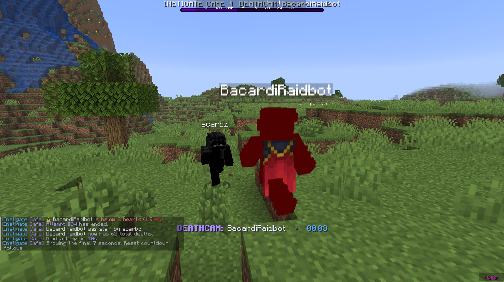

The cinematic Deathcam replays player and nearby entity movement, equipment, combat animations, creeper explosions, sounds, and camera tracking. When terrain capture is enabled, it also reconstructs recorded block and environmental changes. Playback uses temporary client-side packets and block overrides; it does not modify the live world.

### Automatic world rotation

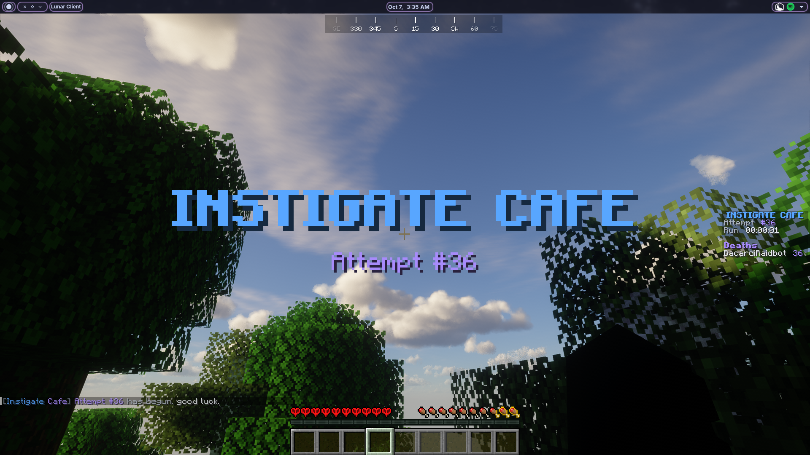

Each attempt has an isolated **Overworld, Nether, and End** sharing one attempt seed. The plugin maintains an **active** world set and a **standby** world set, preloads the next spawn area, and safely retires completed attempts with ownership verification and symlink protections. Rotation state is persisted for deterministic recovery after a normal restart or interrupted rotation.

---

## Features

| System | What it does |
| --- | --- |
| **Shared hardcore** | A participating player's death in any active dimension ends the group's attempt. |
| **Seamless progression** | Numbered attempts promote pre-generated standby worlds without disconnecting players. |
| **Cinematic Deathcam** | Reconstructs the final seven seconds when a replay and PacketEvents are available. |
| **Hardened world cleanup** | Verifies canonical containment, Paper layout, ownership markers, and non-symlink safety before deleting retired worlds. |
| **Persistent statistics** | Tracks deaths, attempts played, active playtime, death causes, and recent deaths. |
| **Live scoreboard** | Displays the current attempt, run time, and death leaderboard; larger leaderboards rotate through pages. |
| **Attempt participation** | Tracks who joined each attempt, including disconnected participants and configurable late-joiner admission (`players.allow-late-joiners`). |
| **Fresh progression** | Resets inventories, ender chests, XP, vitals, effects, advancements, and phantom insomnia (`TIME_SINCE_REST`) for new attempts. |
| **Crash recovery** | Persists world rotation state (`STABLE` / `ROTATING`) and player records across restarts and interrupted transitions. |

### Quality of life

**Two-tier health alerts.** Active players trigger an orange warning below **5 hearts** and a red critical alert below **2 hearts**. Critical alerts also sound an alarm for everyone online. Each tier has a re-arm threshold to avoid repeated chat spam; warnings stop while an attempt is ending or resetting.

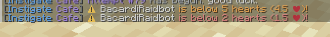

**Health in TAB.** The player list shows everyone's current hearts, color-coded by health: blue normally, orange below 5 hearts, and red below 2 hearts.

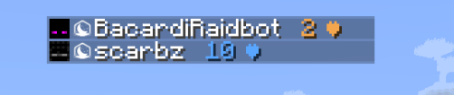

**Share coordinates.** `/hc coords` broadcasts your current block coordinates and dimension to chat during an active attempt. Click the coordinates in chat to copy them.

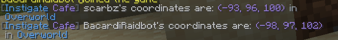

**At-a-glance scoreboard.** Track the current attempt, its run time, and the server's death counts as you play.

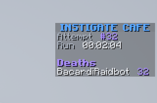

---

## Gallery

<details>
<summary><strong>More screenshots — commands, statistics, and attempt transitions</strong></summary>

### Server status

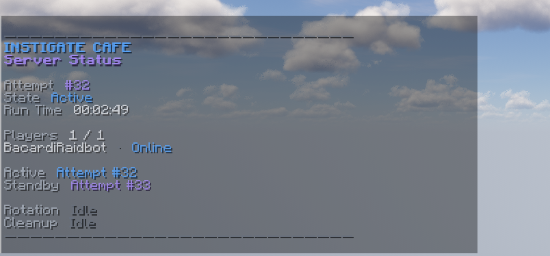

### Player statistics

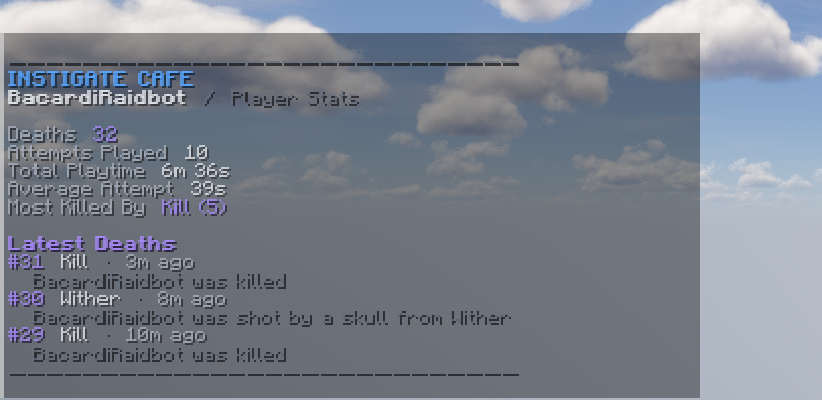

### Death leaderboard

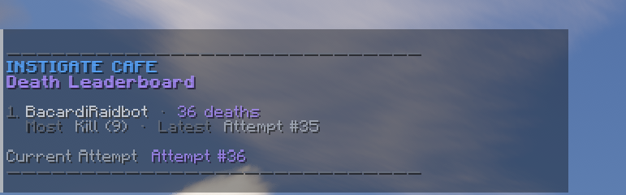

### World inspection

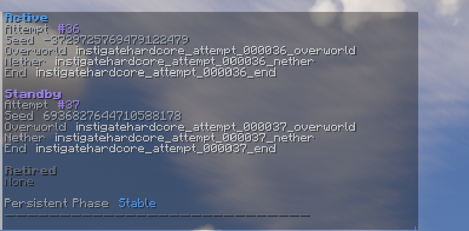

### Attempt end

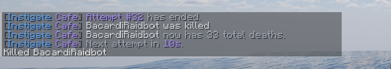

</details>

---

## Installation

### Supported versions & requirements

- **Minecraft / Paper:** `26.3` (only Paper `26.3` is supported and tested)
- **Java:** `25`
- **PacketEvents:** `2.14.0` (optional; required for rendered Deathcam playback — the core shared-hardcore and world-rotation systems work without it)

### Setup

1. Download `InstigateHardcore-1.0.4.jar` from [Releases](https://github.com/sukesan7/instigate-hardcore-plugin/releases), or [build it from source](#development).
2. Place the JAR into your Paper server's `plugins/` directory. Install the matching PacketEvents `2.14.0` server plugin there too if you want rendered Deathcam playback.
3. Start and stop the server once to generate `plugins/InstigateHardcore/config.yml`.
4. Review `plugins/InstigateHardcore/config.yml` — especially **`worlds.lobby-world`** — then start the server normally (do not use `/reload`).

No client-side mod is required; vanilla Minecraft and compatible clients can connect.

> [!WARNING]
> **Automatic World Deletion & Backups:** This plugin **creates, unloads, and deletes attempt worlds** during normal operation. Always back up your server before installing or upgrading, test first in a disposable environment, and verify that `worlds.lobby-world` identifies your permanent safety world (never an `attempt_*` world).

---

## Commands

All standard commands use `/hardcore` or its alias `/hc`.

| Player command | Description |
| --- | --- |
| `/hc` or `/hc help` | Show the command overview. |
| `/hc status` | View the current attempt, participants, and rotation state. |
| `/hc stats [player]` | View your own or another player's statistics. |
| `/hc deaths` | Show the death leaderboard. |
| `/hc coords` | Broadcast your coordinates and dimension during an active attempt. |

| Operator command | Description |
| --- | --- |
| `/hc reset` | Request a manual attempt reset (30-second confirmation window). |
| `/hc reset confirm` | Confirm the manual reset (no player death is recorded). |
| `/hc worlds` | Inspect active, standby, and retired worlds. |
| `/hc debug` | Show internal diagnostics and state integrity checks. |
| `/hcreplaytest <player> [pov\|cinematic]` | Operator-only preview of recent Deathcam footage (disabled by default; requires `death-replay.debug-preview-enabled: true`). |

**Permissions:**
- `instigatehardcore.command` (`default: true`) — access to player `/hc` subcommands.
- `instigatehardcore.admin` (`default: op`) — `/hc reset` and `/hc worlds`.
- `instigatehardcore.debug` (`default: op`) — `/hc debug` and `/hcreplaytest`.

Replay previews additionally require `death-replay.debug-preview-enabled: true`, PacketEvents, an operator in spectator mode, and an online survival target within 48 blocks in the same dimension.

---

## Configuration

The plugin generates its default configuration at `plugins/InstigateHardcore/config.yml`. Below is the production-safe configuration surface (including optional QoL keys supported with built-in defaults):

```yaml
reset:
  countdown-seconds: 10            # allowed: 1..600

players:
  allow-late-joiners: true         # false holds new joiners in lobby until next attempt

scoreboard:
  enabled: true
  update-interval-ticks: 20        # allowed: 1..1200
  page-interval-seconds: 10        # optional, allowed: 1..300

tab-health:                        # optional section (enabled by default)
  enabled: true
  update-interval-ticks: 10        # allowed: 1..1200

alerts:                            # optional section (enabled by default)
  low-health:
    enabled: true
    warning-hearts: 5.0
    warning-rearm-hearts: 6.0
    threshold-hearts: 2.0
    rearm-hearts: 3.0
    critical-sound-enabled: true

advancements:                      # optional section (enabled by default)
  reset-per-attempt: true

death-replay:
  enabled: true
  automatic-playback-enabled: true
  debug-preview-enabled: false     # production default; set true only for operator testing
  duration-seconds: 7              # allowed: 1..30 (must be < reset.countdown-seconds)
  capture-interval-ticks: 2        # allowed: 1..20
  capture-radius-blocks: 24        # allowed: 1..64
  max-actors-per-frame: 48         # allowed: 1..128
  audio:
    enabled: true
  cinematic:
    enabled: true
    hide-scoreboard: true
    resource-pack-hud-enabled: false # EXPERIMENTAL — see below
  terrain:
    enabled: true
    capture-radius-blocks: 24      # allowed: 1..64
    max-changes-per-clip: 1024     # allowed: 1..4096
    max-block-packets-per-tick: 128

worlds:
  lobby-world: world
  preload-radius-chunks: 1         # allowed: 0..8
```

See [`src/main/resources/config.yml`](src/main/resources/config.yml) for the complete shipped configuration file. Invalid or out-of-range numeric settings log a startup warning and fall back to safe defaults rather than failing startup.

### Experimental functionality

- **`death-replay.cinematic.resource-pack-hud-enabled` (default `false`):** Experimental custom-font HUD layout for Deathcam playback. No resource pack is bundled with this plugin; enabling this option without serving a matching client resource pack will render placeholder font glyphs instead of the standard vanilla bossbar/title HUD. Keep disabled in standard installations.

### Upgrading from `v1.0.0`–`v1.0.3`

Because Paper's `saveDefaultConfig()` preserves your existing `plugins/InstigateHardcore/config.yml` across upgrades, existing installations should manually apply the safer `v1.0.4` defaults:

1. **Back up** your server directory and `plugins/InstigateHardcore/` data files before upgrading.
2. In `plugins/InstigateHardcore/config.yml`, set **`death-replay.debug-preview-enabled: false`** (earlier releases shipped with `true`).
3. Confirm **`death-replay.cinematic.resource-pack-hud-enabled: false`** remains disabled.
4. Optional cleanup: earlier `config.yml` files indented `audio.enabled` under `death-replay.terrain.audio.enabled`; `v1.0.4` reads `death-replay.audio.enabled` and remains backwards-compatible with the legacy nested key.
5. Verify `worlds.lobby-world` points to your permanent lobby world and numeric settings fall within documented bounds (`reset.countdown-seconds: 1..600`, `worlds.preload-radius-chunks: 0..8`).
6. Replace the plugin JAR with `InstigateHardcore-1.0.4.jar` and perform a full server restart.
   - Active and standby worlds listed in your existing `world-state.properties` will automatically receive `.instigatehardcore-owner.properties` ownership markers on startup so future rotations can clean them up safely.
   - Any older orphaned or unrelated world folders on disk are never claimed or deleted automatically.

The plugin stores persistent data under `plugins/InstigateHardcore/` (`stats.properties`, `attempt-participants.properties`, `player-telemetry.yml`, `world-state.properties`). Normal restarts preserve these records. Administrative resets use the normal countdown rather than Deathcam.

---

## Development

```bash
# Run automated unit and security regression tests
./gradlew clean test

# Build and verify the release plugin JAR (includes META-INF/LICENSE.md)
./gradlew clean build

# Start the disposable local Paper 26.3 development server
./gradlew runServer
```

Further documentation: [Architecture](docs/ARCHITECTURE.md) · [Development guide](docs/DEVELOPMENT.md) · [Roadmap & Maintenance Status](docs/ROADMAP.md) · [Security Policy](SECURITY.md)

## License

Licensed under the [MIT License](LICENSE.md). Built for **Instigate Cafe**.
