<div align="center">
  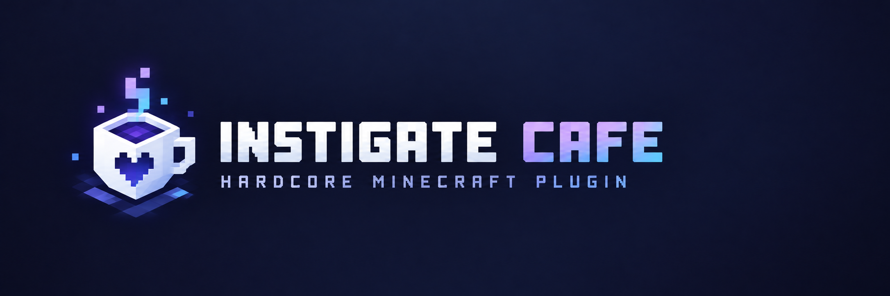
</div>

# Instigate Cafe Hardcore

**One death ends the run for everyone.**

A shared hardcore survival plugin for Minecraft Paper servers. Play together across all three dimensions, survive as long as you can, and start a fresh attempt automatically when someone dies.

**Paper 26.3** · **Java 25** · **PacketEvents 2.14.0** (optional, for Deathcam) · **No client mods**

[How it works](#how-it-works) · [Features](#features) · [Gallery](#gallery) · [Installation](#installation) · [Commands](#commands) · [Configuration](#configuration)

---

## How it works

Every run is an **attempt**, shared by everyone playing in its Overworld, Nether, and End.

1. **Survive together.** Players explore a single active attempt while the next world set is prepared in the background.
2. **One player dies.** The attempt ends for the entire group, and everyone moves into spectator mode at the death location.
3. **Watch the final moments.** When available, a seven-second **Deathcam** reconstructs the death, followed by a three-second reset buffer. Otherwise, the normal reset countdown runs.
4. **Begin again.** The standby attempt becomes active, players are reset, the completed worlds are cleaned up, and another standby attempt is prepared — **no server restart required**.

`ACTIVE ATTEMPT` → `PLAYER DEATH` → `7s DEATHCAM + 3s BUFFER` → `STANDBY PROMOTED` → `NEW ATTEMPT`

### Deathcam

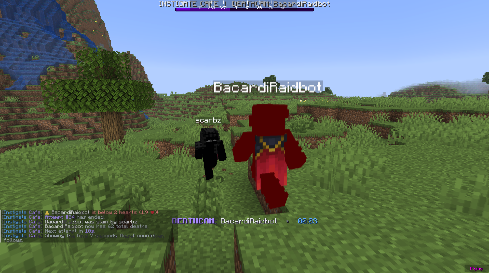

The cinematic Deathcam replays player and nearby entity movement, equipment, combat effects, sounds, and camera movement. When terrain capture is enabled, it can also show recorded block and environmental changes. Playback uses temporary client-side visuals; it does not modify the live world.

### Automatic world rotation

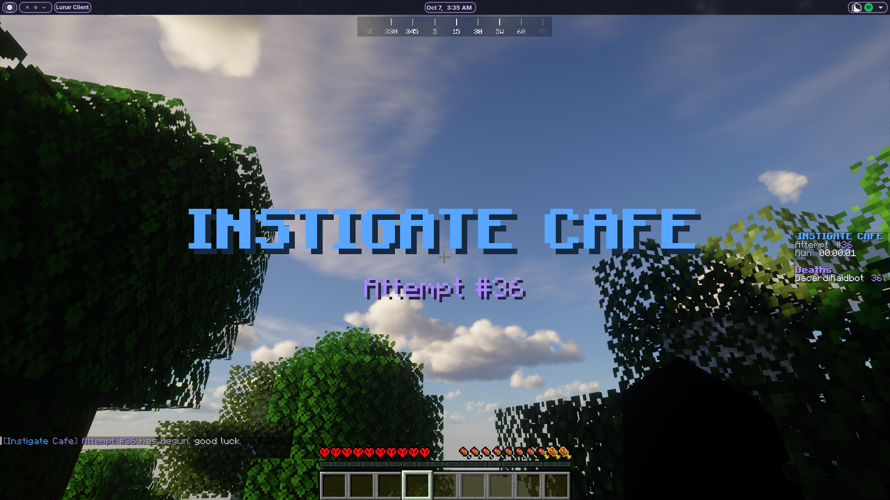

Each attempt has a separate **Overworld, Nether, and End**. The plugin maintains an **active** world set and a **standby** world set, preloads the next spawn area, and safely retires completed attempts. Rotation state is persisted for recovery after a server restart.

---

## Features

| System | What it does |
| --- | --- |
| **Shared hardcore** | A participating player's death in any active dimension ends the group's attempt. |
| **Instant progression** | Numbered attempts transition to pre-generated standby worlds without disconnecting players. |
| **Cinematic Deathcam** | Reconstructs the final seven seconds when a replay and PacketEvents are available. |
| **Persistent statistics** | Tracks deaths, attempts played, active playtime, death causes, and recent deaths. |
| **Live scoreboard** | Displays the current attempt, run time, and death leaderboard; larger leaderboards rotate through pages. |
| **Attempt participation** | Tracks who joined each attempt, including disconnected participants and optional late joiners. |
| **Fresh progression** | Resets inventories, player state, and advancements for new attempts. |
| **Crash recovery** | Persists world rotation state and player records between normal restarts. |

### Quality of life

**Two-tier health alerts.** Active players trigger an orange warning below **5 hearts** and a red critical alert below **2 hearts**. Critical alerts also sound an alarm for everyone online. Each tier has a recovery threshold to avoid repeated chat spam; warnings stop while an attempt is ending or resetting.

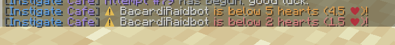

**Health in TAB.** The player list shows everyone's current hearts, color-coded by health: blue normally, orange below 5 hearts, and red below 2 hearts.

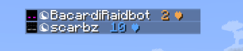

**Share coordinates.** `/hc coords` broadcasts your current block coordinates and dimension to chat during an active attempt. Click the coordinates in chat to copy them.

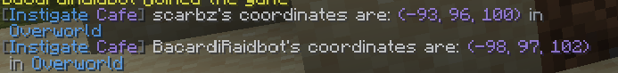

**At-a-glance scoreboard.** Track the current attempt, its run time, and the server's death counts as you play.

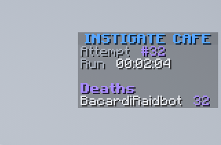

---

## Gallery

<details>
<summary><strong>More screenshots — commands, statistics, and attempt transitions</strong></summary>

### Server status

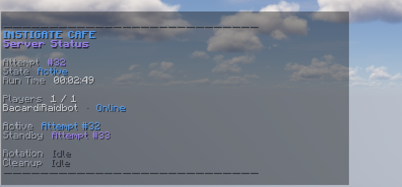

### Player statistics

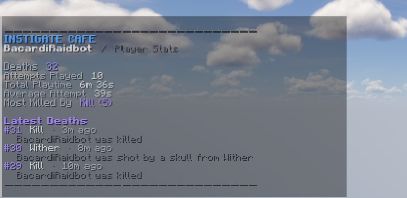

### Death leaderboard

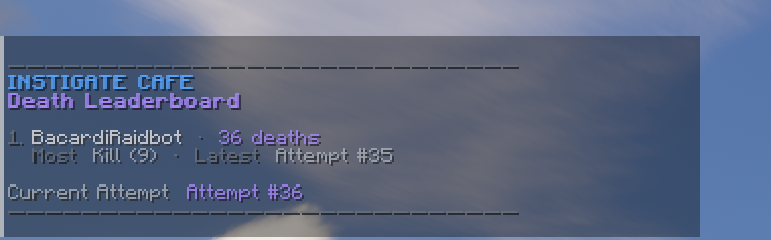

### World inspection

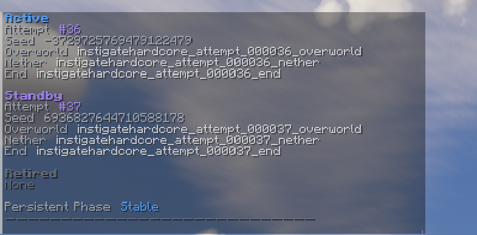

### Attempt end

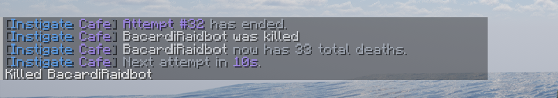

</details>

---

## Installation

### Requirements

- **Minecraft / Paper:** 26.3
- **Java:** 25
- **PacketEvents:** 2.14.0, required for rendered Deathcam playback; the core hardcore/reset system works without it

### Setup

1. Obtain the plugin JAR from [Releases](https://github.com/sukesan7/instigate-hardcore-plugin/releases) if available, or [build it from source](#development).
2. Put `InstigateHardcore-<version>.jar` into your Paper server's `plugins/` directory. Install the compatible PacketEvents server plugin there too if you want Deathcam playback.
3. Start and stop the server once to generate `plugins/InstigateHardcore/config.yml`.
4. Review the configuration, especially **`worlds.lobby-world`**, then restart the server.

No client-side installation is required; vanilla Minecraft and compatible clients can connect.

> [!WARNING]
> The plugin **creates and deletes attempt worlds** during normal operation. Back up your server, use a separate test environment first, and ensure `worlds.lobby-world` identifies your permanent safety world — not a world you want rotated or deleted.

---

## Commands

All standard commands use `/hardcore` or its shorter alias, `/hc`.

| Player command | Description |
| --- | --- |
| `/hc` or `/hc help` | Show the command overview. |
| `/hc status` | View the current attempt, participants, and rotation state. |
| `/hc stats [player]` | View your own or another player's statistics. |
| `/hc deaths` | Show the death leaderboard. |
| `/hc coords` | Broadcast your coordinates and dimension during an active attempt. |

| Operator command | Description |
| --- | --- |
| `/hc reset` | Request a manual attempt reset. |
| `/hc reset confirm` | Confirm the manual reset (no player death is recorded). |
| `/hc worlds` | Inspect active, standby, and retired worlds. |
| `/hc debug` | Show internal diagnostics. |
| `/hcreplaytest <player> [pov\|cinematic]` | Preview recent Deathcam footage, if debug preview is enabled. |

**Permissions:** `instigatehardcore.command` (everyone), `instigatehardcore.admin` (operators), and `instigatehardcore.debug` (operators). Replay previews additionally require an operator in spectator mode and an eligible nearby survival player.

---

## Configuration

The plugin generates its settings at `plugins/InstigateHardcore/config.yml`. This is a **sample of common options**, including optional QoL settings and a production-safe replay preview setting:

```yaml
reset:
  countdown-seconds: 10

players:
  allow-late-joiners: true

scoreboard:
  enabled: true
  update-interval-ticks: 20
  page-interval-seconds: 10

tab-health:
  enabled: true
  update-interval-ticks: 10

alerts:
  low-health:
    enabled: true
    warning-hearts: 5.0
    warning-rearm-hearts: 6.0
    threshold-hearts: 2.0
    rearm-hearts: 3.0
    critical-sound-enabled: true

death-replay:
  enabled: true
  automatic-playback-enabled: true
  debug-preview-enabled: false
  duration-seconds: 7
  terrain:
    enabled: true

worlds:
  lobby-world: world
  preload-radius-chunks: 1
```

Health alerts and TAB hearts are enabled by default in the current code, even if their optional keys do not appear in the generated file. The repository's current default config enables replay debug previews; **set `death-replay.debug-preview-enabled: false` for production servers**. See [`config.yml`](src/main/resources/config.yml) for the shipped configuration.

The plugin keeps statistics, participation history, player telemetry, and world rotation state on disk. A normal restart preserves these records. Administrative resets use the normal countdown rather than Deathcam.

---

## Development

```bash
# Run automated tests
./gradlew clean test

# Build the plugin JAR
./gradlew clean build

# Start the local Paper development server
./gradlew runServer
```

Further documentation: [Architecture](docs/ARCHITECTURE.md) · [Development guide](docs/DEVELOPMENT.md) · [Roadmap](docs/ROADMAP.md)

## License

Licensed under the [MIT License](LICENSE.md). Built for **Instigate Cafe**.
