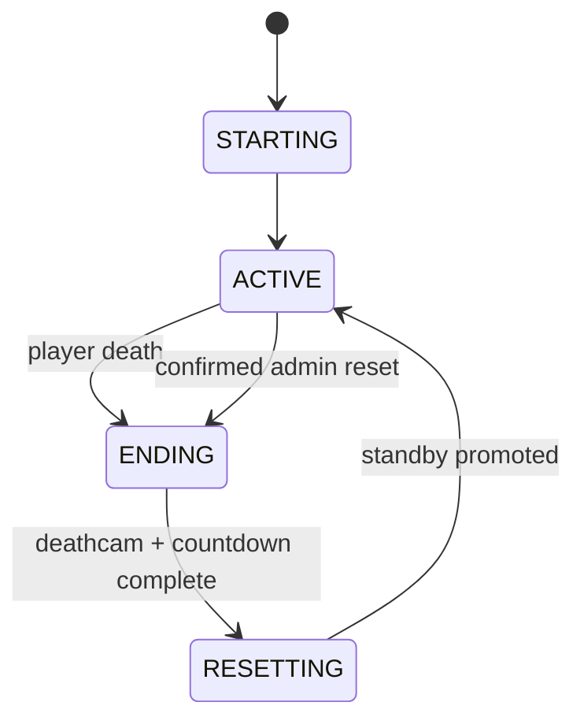
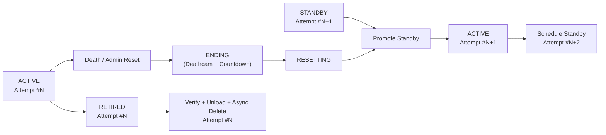

# Architecture

## Overview

**Instigate Hardcore** is a Paper `26.3` (Java `25`) plugin for shared-group hardcore survival.

The core rule is simple:

> If one participating player dies in an active attempt dimension, the current attempt ends for everyone.

The plugin implements that rule with a rotating world pipeline, hardened world-deletion safeguards, persistent attempt state, crash/interrupted-rotation recovery, per-player telemetry, participation tracking, an optional packet-only seven-second Deathcam (via PacketEvents), quality-of-life monitors, and a compact command/diagnostics surface.

Built for **Instigate Cafe** and designed to work cleanly on any standard Paper `26.3` server. The project is feature-complete and in **maintenance mode** (`v1.0.4`).

---

## Design Goals

- One death ends the shared attempt;
- No server restart required between attempts;
- The next attempt is prepared ahead of time as a frozen standby world set;
- Every attempt has an isolated Overworld, Nether, and End sharing one seed;
- Retired worlds are unloaded and deleted only after strict containment, layout, symlink, and ownership verification;
- Player inventories, advancements, vitals, and phantom insomnia (`Statistic.TIME_SINCE_REST`) reset cleanly between attempts without deleting live player `.dat` files;
- Statistics, participation, telemetry, and rotation metadata survive normal restarts and recover from interrupted rotations;
- No client-side mod is required.

---

## High-Level Lifecycle

Every attempt progresses through an explicit state machine owned by `RunManager`:



| State | Meaning |
| --- | --- |
| `STARTING` | Startup initialization and recovery before gameplay begins |
| `ACTIVE` | Normal hardcore gameplay |
| `ENDING` | Attempt has ended; optional Deathcam and reset countdown are running |
| `RESETTING` | Players are resetting/moving and the standby world set is being promoted |

`RunManager` guards all state transitions so only the first valid death or confirmed administrative reset can end an attempt.

---

## World Pipeline & Rotation Model

Normal operation keeps two attempt world sets loaded:

- **ACTIVE** — the attempt currently being played (`attempt_<NNNNNN>_{overworld,nether,end}`).
- **STANDBY** — the next attempt (`active + 1`), pre-generated with spawn chunks preloaded and time/weather frozen at morning (`1000L`, `ADVANCE_TIME=false`, `ADVANCE_WEATHER=false`).

A completed attempt temporarily becomes:

- **RETIRED** — the outgoing active set waiting to be unloaded and removed from disk.

The configured permanent lobby world (`worlds.lobby-world`) is completely separate from attempt rotation and is never treated as an attempt world.



---

## Attempt End & Deathcam Flow

Real player deaths and administrative resets share `AttemptEndManager`, with two intentional differences:

- Only real player deaths record death statistics/telemetry and gather online players as spectators at the death location.
- Only real player deaths trigger automatic Deathcam playback (when `death-replay.enabled`, `death-replay.automatic-playback-enabled`, PacketEvents, and a captured clip are available, and `reset.countdown-seconds > death-replay.duration-seconds`).

```mermaid
sequenceDiagram
    participant Player
    participant Death as DeathListener
    participant End as AttemptEndManager
    participant Replay as DeathReplayCapture / Playback
    participant Run as RunManager
    participant Stats as Stats / Telemetry
    participant Countdown
    participant Rotation as WorldRotationManager

    Player->>Death: dies in ACTIVE world
    Death->>End: endFromPlayerDeath(...)
    End->>Run: ACTIVE -> ENDING
    End->>Replay: freezeOnDeath(...)
    End->>Stats: end playtime + record death
    End->>Replay: play 7s Deathcam (if available)
    Replay-->>End: completion callback
    End->>Countdown: start buffer/reset countdown
    Countdown->>Run: ENDING -> RESETTING
    Countdown->>Rotation: rotateToStandby()
    Rotation->>Rotation: beginRotation -> reset/move players -> promoteStandby
    Rotation->>Stats: advanceAttempt + batch participants
    Rotation->>Run: RESETTING -> ACTIVE
    Rotation->>Stats: begin new playtime sessions
```

If PacketEvents is absent, replay capture fails, or playback fails mid-clip, `AttemptEndManager` transparently falls back to the standard reset countdown so gameplay rotation never stalls.

---

## World Persistence & Crash Recovery

`WorldStateStore` atomically persists `world-state.properties` (format version `2`, rejecting symbolic-link target or temp files):

```text
version=2
phase=STABLE | ROTATING
active.attempt
active.seed
standby.attempt
standby.seed
```

Before moving the first player during rotation, `WorldSetManager.beginRotation()` persists `phase=ROTATING`. On startup, `WorldRecoveryManager.recover()` runs **before** any attempt worlds are loaded:

- If `phase=ROTATING`, recovery promotes the persisted standby attempt to `ACTIVE`, allocates a new replacement standby attempt (`active + 1`) with a fresh seed, persists `phase=STABLE`, and reconciles `StatsManager` when needed.
- If `phase=STABLE` but `world-state.properties` is already one attempt ahead of `stats.properties` (crash between `promoteStandby()` and `advanceAttempt()`), recovery advances `StatsManager` to match.
- `RecoveryResult` records whether `world-state.properties` pre-existed on disk and the exact `(attempt, seed)` pairs that were persisted prior to recovery. This provenance is passed to `WorldSetManager.initialize(...)` for safe legacy ownership-marker migration.

---

## World Deletion Hardening

Retired world deletion is separated into `WorldOwnershipMarker`, `WorldDeletionGuard`, `WorldSetManager`, and `WorldCleanupManager`:

### World Folder Layouts

Paper `26.3` stores custom `NamespacedKey` worlds under the server's primary level directory:

```text
<worldContainer>/<level-name>/dimensions/instigatehardcore/attempt_000012_overworld
<worldContainer>/<level-name>/dimensions/instigatehardcore/attempt_000012_nether
<worldContainer>/<level-name>/dimensions/instigatehardcore/attempt_000012_end
```

`WorldDeletionGuard` explicitly supports both Paper `26.3+` namespaced dimension trees and classic flat world-container layouts (`<worldContainer>/attempt_000012_<dim>` or `<worldContainer>/instigatehardcore_attempt_000012_<dim>`), while rejecting arbitrary paths, ancestor directories (`world`, `world/dimensions`, `world/dimensions/instigatehardcore`), and vanilla `minecraft:*` dimensions.

### Ownership Markers & Safe Migration

Each managed attempt dimension stores `.instigatehardcore-owner.properties`:

```text
schema=1
plugin=InstigateHardcore
namespace=instigatehardcore
world.key=instigatehardcore:attempt_000012_overworld
world.uid=<world-uuid>
attempt=12
dimension=overworld
seed=<attempt-seed>
created.at=<epoch-millis>
migrated=false|true
```

- **Freshly created worlds:** `WorldSetManager` checks existing candidate paths before `WorldCreator.createWorld()`. Newly created worlds receive an atomic ownership marker (`migrated=false`).
- **Existing installations (`v1.0.0`–`v1.0.3`):** Pre-existing unmarked worlds receive a migrated marker (`migrated=true`) **only** when `world-state.properties` already existed on disk with the exact matching `(attempt, seed)` pair and the world passes seed, environment, canonical containment, layout, and symlink verification.
- **Fail-safe refusal:** Pre-existing unmarked worlds not backed by pre-existing persisted state, or worlds with corrupt/mismatched markers, are never claimed or overwritten; `WorldCleanupManager` leaves them untouched on disk.

### Deletion Safeguards & Async Lifecycle

Before unloading and again after unloading (and before deleting on the async thread), `WorldCleanupManager` + `WorldDeletionGuard` enforce:

1. **Canonical containment:** Target resolves via `toRealPath()` strictly inside canonical `worldContainer`.
2. **Symbolic-link rejection:** Refuses symlinks at the target folder, any intermediate segment inside `worldContainer`, the ownership marker file, or any nested file/directory inside the world tree (pre-scanned before deleting a single file, using `Files.walkFileTree` without `FOLLOW_LINKS`).
3. **Explicit protected-world rejection:** Rejects `worldContainer`, `plugin.getDataFolder()`, configured lobby world (and its primary level root), vanilla `minecraft:*` worlds, all `ACTIVE` and `STANDBY` worlds, persisted `active`/`standby` attempt numbers from `world-state.properties`, and any still-loaded Bukkit world (by key, UID, or canonical folder path).
4. **Unload ordering:** Unloads `End` → `Nether` → `Overworld` on the main thread when Paper is not ticking worlds and zero players remain inside the retired set, then clears `retiredWorldSet` and dispatches filesystem removal to Paper's async scheduler.
5. **Async completion tracking & shutdown:** `WorldCleanupManager.isCleanupInProgress()` remains `true` until both unloading and asynchronous filesystem removal finish (cleared in `finally`). On `onDisable()`, `WorldCleanupManager.shutdown()` cancels pending unload retries, stops starting new folder deletions, waits briefly (up to 5 seconds) for in-flight async deletion to finish, and logs any interrupted attempts clearly.

---

## Player Lifecycle & Admission

- **Admission (`AttemptAdmissionPolicy`):** When `players.allow-late-joiners: true` (default), new players may enter an `ACTIVE` attempt mid-run. When `false`, only players already recorded as participants in the current attempt may enter once at least one participant exists; new joiners wait in the safety lobby in spectator mode until the next attempt.
- **Joining (`PlayerJoinListener`):** Ensures stats registration, assigns the scoreboard, and uses a short delayed verification sequence to place players into `ACTIVE` survival gameplay. First-time participants for the current attempt receive a full clean reset (`PlayerResetManager.prepareForNewAttempt`); reconnecting participants preserve their inventory and progress.
- **Player reset (`PlayerResetManager`):** Clears inventory, armor, offhand, ender chest, cursor item, XP, potion effects, fire/freeze/velocity/sprint/sneak transient state, resets health/hunger/saturation, and zeros `Statistic.TIME_SINCE_REST` (phantom insomnia reset). Never deletes live player `.dat` files.
- **Advancement reset (`AttemptAdvancementResetListener`):** Revokes earned advancements once per new attempt using a PersistentDataContainer marker (`instigatehardcore:advancements_reset_attempt`), so dimension travel or reconnecting within the same attempt preserves advancements.
- **Disconnecting (`PlayerQuitListener`):** Commits the active telemetry playtime session while keeping historical participation intact.
- **Rotation batching (`WorldRotationManager` + `AttemptParticipantManager`):** Transfers online players into the promoted standby attempt and records all participants in a single atomic save.

---

## Portals & Dimension Isolation

`PortalRoutingListener` intercepts `PlayerPortalEvent` and `EntityPortalEvent` for managed worlds:

- Routes Nether portals strictly between `ACTIVE Overworld ↔ ACTIVE Nether`.
- Routes End portals from `ACTIVE Overworld → ACTIVE End`, and End exits back to the player's attempt-local respawn point (or `ACTIVE Overworld` spawn).
- Cancels portal travel while not `ACTIVE` or from lobby, `STANDBY`, or `RETIRED` worlds.
- Leaves End gateways untouched inside the active End.

---

## Deathcam / Replay Subsystem

Located in `dev.instigatehardcore.replay`:

- **Capture (`DeathReplayRecorder`, `ReplayCombatRecorder`, `ReplayBlockRecorder`, `DeathReplayCaptureService`):** Main-thread-only bounded rolling buffers capturing Survival players, nearby entities, equipment, movement/fire/creeper state, combat animations, explosions, and optional block/environment changes within configured bounds.
- **Playback (`DeathReplayPlaybackService`, `ReplayPacketActorTransport`, `ReplayCinematicView`, `ReplayTerrainOverlay`):** Packet-only rendering via optional PacketEvents `2.14.0`. Hides live conflicting entities per viewer, spawns temporary ghost actors, renders optional client-only terrain overrides, and tracks the victim with a packet-only cinematic marker camera. Every viewer resource is torn down transactionally on completion, error, quit, or disable.
- **Experimental resource-pack HUD (`ResourcePackReplayHud`):** Opt-in via `death-replay.cinematic.resource-pack-hud-enabled` (default `false`); no resource pack is bundled.
- **Operator debug preview (`ReplayDebugPreviewCommand`):** `/hcreplaytest <player> [pov|cinematic]` requires `instigatehardcore.debug`, `death-replay.debug-preview-enabled: true` (default `false`), PacketEvents, spectator mode, and proximity within 48 blocks.

---

## Quality-of-Life & UI Systems

- **`InstigateTheme`:** Centralized Adventure RGB styling (`[Instigate Cafe]` prefix, azure/purple/neutral gray palette, soft red for errors).
- **`HardcoreScoreboardManager`:** Compact sidebar (`Attempt`, `Run`, paginated `Deaths` with blank Paper `NumberFormat`). Diffs lines on each refresh so unchanged rows do not resend scoreboard packets.
- **`LowHealthAlertMonitor` + `TieredHealthAlertPolicy`:** Broadcasts warning (<5 hearts, re-arm 6) and critical (<2 hearts, re-arm 3, two-note bell alarm) alerts during `ACTIVE` gameplay only.
- **`TabHealthDisplay` + `HeartDisplayFormatter`:** Displays color-coded numeric hearts in the player list while preserving other plugins' baseline list names and restoring them cleanly on disable.

---

## Persistent Data Files

All plugin data lives under `plugins/InstigateHardcore/`:

| File | Owner | Contents |
| --- | --- | --- |
| `stats.properties` | `StatsManager` | Current attempt number, player UUIDs, latest names, total deaths |
| `attempt-participants.properties` | `AttemptParticipantManager` | Per-attempt existence markers, participant UUIDs, latest names, first-join timestamps |
| `player-telemetry.yml` | `PlayerTelemetryManager` | Per-attempt playtime (checkpointed every 60s), structured death history (attempt, timestamp, cause, message) |
| `world-state.properties` | `WorldStateStore` | Rotation format version, `STABLE`/`ROTATING` phase, active/standby attempts and seeds |

Additionally, each managed attempt world folder stores `.instigatehardcore-owner.properties` (`WorldOwnershipMarker`).

---

## Startup & Shutdown Sequences

### Startup (`InstigateHardcore.onEnable`)

1. Save default `config.yml` if missing and validate numeric config bounds via `ConfigBounds`.
2. Load `StatsManager`.
3. Run `WorldRecoveryManager.recover()` and initialize `WorldSetManager` (passing pre-existing attempt provenance for safe legacy marker migration).
4. Load `AttemptParticipantManager` and `PlayerTelemetryManager`.
5. Transition `RunManager` to `ACTIVE`.
6. Initialize `PlayerResetManager`, `CountdownManager`, `HardcoreScoreboardManager`, `WorldCleanupManager`, `WorldRotationManager`, `AttemptEndManager`.
7. Initialize optional Deathcam recorders/capture (`DeathReplayRecorder`, `ReplayCombatRecorder`, `ReplayBlockRecorder`, `DeathReplayCaptureService`).
8. Register core listeners (`DeathListener`, `PortalRoutingListener`, `PlayerJoinListener`, `PlayerQuitListener`) and QoL services (`AttemptAdvancementResetListener`, `LowHealthAlertMonitor`, `TabHealthDisplay`).
9. Register commands (`/hardcore` / `/hc` and optional `/hcreplaytest`) and optional automatic `DeathReplayPlaybackService`.
10. Start telemetry checkpoint timer, start scoreboard, register any already-online players, and log startup state.

### Shutdown (`InstigateHardcore.onDisable`)

1. Stop QoL tasks (`TabHealthDisplay`, `LowHealthAlertMonitor`).
2. Close Deathcam playback, preview sessions, block recorder, capture service, and frame recorder.
3. Cancel telemetry checkpoint task and `CountdownManager`.
4. Shut down `WorldRotationManager` (cancel pending standby generation) and `WorldCleanupManager` (cancel pending unload retries, wait briefly for in-flight async deletion).
5. Stop `HardcoreScoreboardManager` and restore players' main scoreboard.
6. Finalize and save `PlayerTelemetryManager`, `StatsManager`, and `AttemptParticipantManager`.

---

## Package Layout

```text
dev.instigatehardcore
├── InstigateHardcore.java
├── command         # HardcoreCommand, HardcoreTabCompleter
├── core            # RunManager, RunState, AttemptEndManager, AttemptEndReason, ConfigBounds
├── countdown       # CountdownManager
├── listener        # Death, Join, Quit, PortalRouting, AdvancementReset, LowHealthAlertMonitor
├── participation   # AttemptParticipantManager, AttemptParticipant, AttemptAdmissionPolicy
├── player          # PlayerResetManager (including phantom insomnia reset)
├── replay          # Deathcam capture, models, packet playback, terrain overlay, cinematic HUD, debug preview
├── scoreboard      # HardcoreScoreboardManager
├── stats           # StatsManager, PlayerStats
├── telemetry       # PlayerTelemetryManager, PlayerDeathRecord
├── ui              # InstigateTheme, TabHealthDisplay, HeartDisplayFormatter
└── world           # WorldSet, WorldSetManager, WorldRotationManager, WorldCleanupManager,
                    # WorldRecoveryManager, WorldStateStore, WorldDeletionGuard, WorldOwnershipMarker
```

---

## Core Invariants

1. Active world attempt equals `StatsManager` current attempt during `ACTIVE` state.
2. Standby attempt normally equals `active + 1` and remains frozen until activation.
3. Persistent phase is `STABLE` during normal `ACTIVE` gameplay and `ROTATING` only across the rotation transaction.
4. A player death can end an attempt at most once; administrative resets never record a player death.
5. Retired worlds are never treated as active gameplay worlds and are never deleted without passing containment, layout, symlink, protection, and ownership verification.
6. The permanent lobby world and vanilla `minecraft:*` dimensions can never be deleted.
7. Participation is unique per UUID per attempt; playtime accumulates only during `ACTIVE` gameplay.

---

## Related Documentation

- [`../README.md`](../README.md) — overview, installation, commands, and upgrade instructions
- [`../SECURITY.md`](../SECURITY.md) — vulnerability reporting and data-loss safeguards
- [`DEVELOPMENT.md`](DEVELOPMENT.md) — local build, supply-chain verification, and regression testing
- [`ROADMAP.md`](ROADMAP.md) — release history, maintenance status, and explicit non-goals
